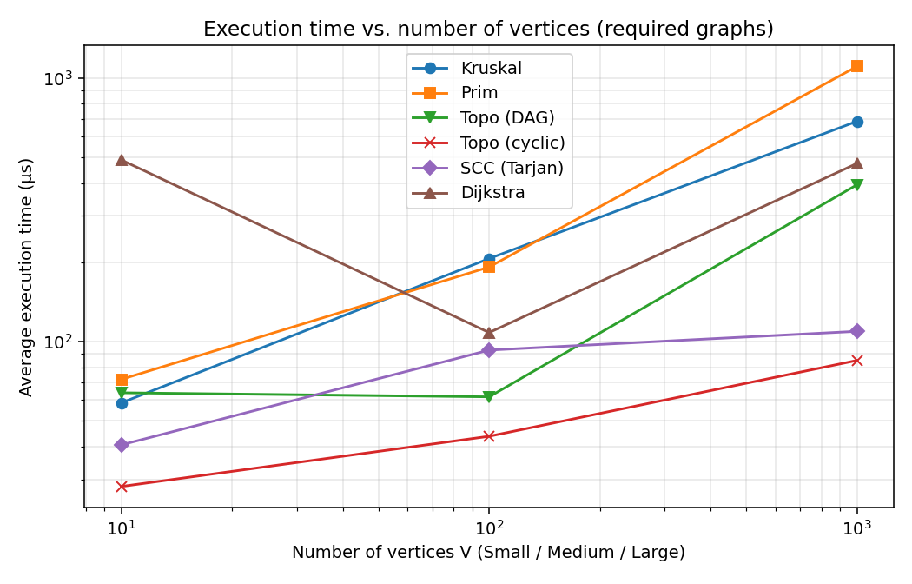
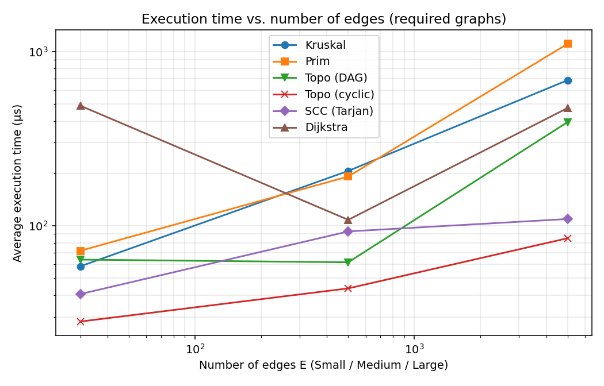
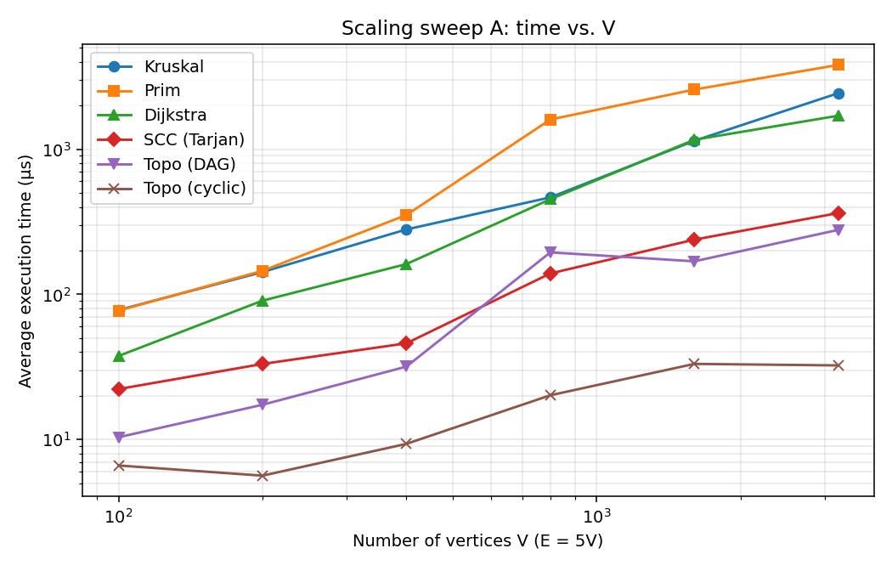
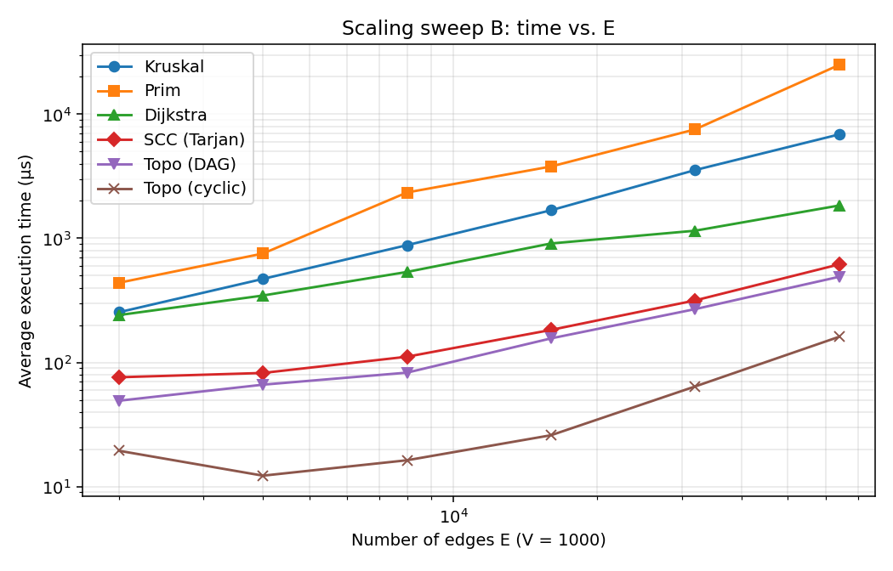

# Assignment 3 — Smart City Infrastructure and Route Planning

Java implementation and analysis of graph algorithms for a smart-city network: DSU, Kruskal, Prim, topological ordering, Tarjan SCC and Dijkstra, with experiments on graphs of 3 sizes.

**Quick start:** `run.sh` (needs a JDK 17+ and Python 3 with matplotlib) compiles everything, runs the 23 correctness checks, runs all experiments and regenerates `results/tables/` and `results/plots/`.

```
assignment-3/
├── src/
│   ├── graph/          Edge, Graph (adjacency list), GraphGenerator (seeded)
│   ├── dsu/            DSU (path compression + union by rank, each switchable)
│   ├── mst/            Kruskal, Prim, MSTResult
│   ├── connectivity/   TopologicalSort (Kahn), SCC (Tarjan)
│   ├── shortestpath/   Dijkstra
│   └── app/            Benchmark (experiments), Tests (correctness checks)
├── scripts/plot.py     draws the plots from results/tables/timing.csv
├── results/
│   ├── tables/         tables.md, timing.csv
│   └── plots/          *.png
└── run.sh
```

## 1. Overview

A city is modelled as a graph: **vertices** are districts, **edges** are roads / infrastructure links, **weights** are construction cost (MST task) or distance (shortest-path task). Directed edges model one-way roads or dependencies between services.

**Graph representation.** `Graph` keeps an adjacency list (`List<List<Edge>>`) and a flat edge list. For an undirected graph an edge is stored once in the edge list (Kruskal sorts it) and in both adjacency lists (Prim, Dijkstra). Vertices are `0..n-1`, weights are `int`. Space is O(V + E).

| Task | Algorithm | Class |
|---|---|---|
| Minimum spanning tree | Kruskal + DSU | `mst.Kruskal`, `dsu.DSU` |
| Minimum spanning tree | Prim + binary-heap priority queue | `mst.Prim` |
| Topological order / cycle detection | Kahn's algorithm | `connectivity.TopologicalSort` |
| Strongly connected components | Tarjan | `connectivity.SCC` |
| Shortest paths | Dijkstra + binary heap | `shortestpath.Dijkstra` |

## 2. Implementation

* **DSU.** `find` is iterative with two passes (find root, then point every node of the path at the root = path compression). `union` links the root of lower rank under the root of higher rank (union by rank). Both optimisations can be turned off via constructor flags, so the experiments can measure their individual effect. Counters: `findCalls` (includes the two finds inside every `union`), `unionCalls`, `parentSteps` (parent-pointer hops).
* **Kruskal.** Sorts a copy of the edge list by weight, scans it and adds an edge when `dsu.union` merges two different sets. It stops as soon as n−1 edges are chosen. If the loop ends with more than one DSU component the graph is reported as **not connected** and the result is a minimum spanning forest.
* **Prim.** Binary-heap `PriorityQueue` with *lazy deletion*: every edge to an unvisited vertex is pushed, stale entries are skipped when polled. It is restarted from every unvisited vertex, so disconnected graphs give a spanning forest and `connected = false`, comparable with Kruskal.
* **Topological ordering.** Kahn's algorithm (in-degrees + queue). If fewer than V vertices are output, the graph contains a cycle and no ordering exists (`isDag = false`).
* **SCC.** Tarjan's algorithm (one DFS, low-link values, vertex stack). Every vertex ends up in exactly one component. Recursive DFS; the benchmark runs in a thread with a large stack.
* **Dijkstra.** Binary heap with lazy deletion. Unreachable vertices keep `dist = Long.MAX_VALUE` and `pathTo` returns an empty list for them. Negative weights are rejected with `IllegalArgumentException`.
* **Operation counters.** *Edge examinations* = edges (or adjacency entries) looked at; *comparisons* = comparator calls of the sort / heap; *DSU finds / unions*; *PQ pushes / pops*; Dijkstra: relaxations tried / successful.

**Why Dijkstra does not work with negative edges.** Dijkstra is greedy: when it pops a vertex with the smallest tentative distance, it treats that distance as final, because any other path to the vertex must first reach a vertex that is at least as far away and can only add a non-negative amount. A negative edge breaks this argument. Example: `0→1 (4)`, `0→2 (5)`, `2→1 (−3)`. Dijkstra finalizes vertex 1 with distance 4 before it ever looks at vertex 2, but the true shortest path is 0→2→1 with length 2. Re-opening finalized vertices makes the method incorrect or exponentially slow (and a negative cycle has no shortest path at all). For such graphs use Bellman–Ford (O(V·E)). The implementation refuses negative weights.

## 3. Complexity Analysis

Assumptions: adjacency list; binary heap (`java.util.PriorityQueue`) with lazy deletion; V vertices, E edges; α is the inverse Ackermann function (≤ 4 for any practical n).

| Algorithm | Time | Extra space | How V and E affect it |
|---|---|---|---|
| DSU `find` / `union` (both optimisations) | amortized O(α(n)) per operation | O(V) | independent of E; m operations cost O(m·α(V)) |
| DSU, only path compression | amortized O(log n) | O(V) | |
| DSU, only union by rank | O(log n) worst case | O(V) | |
| DSU, neither | O(n) worst case (chains) | O(V) | |
| Kruskal | O(E log E + E·α(V)) = **O(E log V)** | O(V + E) | sorting the E edges dominates, so time follows E; V only matters through the DSU and the early stop after V−1 tree edges |
| Prim (binary heap, lazy) | O(E log E) = **O(E log V)** | O(V + E) | every edge can enter the heap once per direction, so E drives time; heap holds up to E entries |
| Topological ordering (Kahn) | **O(V + E)** | O(V) | linear in both |
| SCC (Tarjan) | **O(V + E)** | O(V) (+ recursion depth up to V) | linear in both; each edge examined exactly once |
| Dijkstra (binary heap, lazy) | O(E log E) = **O((V + E) log V)** | O(V + E) | E relaxations, each may cost a heap push; V pops |

**DSU: why the optimisations matter.** Without them, repeated naive linking can build a chain of length n, so one `find` costs O(n). *Union by rank* keeps the tree height ≤ log n by attaching the shallower tree under the deeper one. *Path compression* flattens every visited path so that later finds on the same nodes are O(1). Together they give the α(n) amortized bound. See the measurements in Results §2.

**Prim vs Kruskal.** Both are O(E log V) here. Kruskal is simpler and benefits from early termination and a very cache-friendly sort; Prim with a binary heap is preferable for dense graphs when implemented with an adjacency matrix (O(V²)) or a Fibonacci heap (O(E + V log V)), which was not required here.

## 4. Experimental Setup

* **Graph sizes:** Small V=10, E=30; Medium V=100, E=500; Large V=1000, E=5000.
* **Generation (reproducible, `java.util.Random` with fixed seed 42):**
  * *Undirected connected graph* (MST and Dijkstra): a random spanning tree is built first (each vertex in a random permutation is joined to a random earlier vertex), which guarantees connectivity; then random extra edges without self-loops or duplicates are added until E is reached. Weights uniform in [1, 100], so duplicate weights occur.
  * *Directed graph with cycles* (SCC, cyclic topological input): E distinct random directed edges, no self-loops, seed 43. Cycles are not forced by construction, but were verified: Kahn's algorithm reports "not a DAG" for all three sizes and the largest SCC contains 8 / 97 / 987 vertices (see §5.4).
  * *Random DAG*: a random hidden vertex order is drawn and every edge points forward in this order, seed 42, so it is acyclic by construction.
* **Dijkstra** runs from source 0 on the connected undirected graphs.
* **Measurement:** for each algorithm and graph, 100 untimed warm-up runs (JIT), a `System.gc()`, then **5 timed runs**; the table shows the mean of the `System.nanoTime()` differences. Each run builds all its data structures (e.g. a new DSU), so operation counters are per run. Operation counts are deterministic; times are not.
* **Extra scaling sweeps** (to draw meaningful plots, since the three required sizes give only three points): Sweep A: E = 5V with V = 100…3200; Sweep B: V = 1000 with E = 2000…64000.
* **Environment of the reported run:** Java 21, Linux, a sandbox with **1 logical CPU**. Timings on a 1-CPU machine are noisy (JIT and GC threads compete with the benchmark). Re-running `run.sh` on your own machine regenerates every table and plot.

## 5. Results

_Environment: Java 21.0.10, Linux, 1 logical CPUs. Seed = 42, 100 warm-up runs, mean of 5 timed runs (System.nanoTime), edge weights uniform in [1, 100]._

### 1. MST: Kruskal vs Prim

#### MST results (connected undirected graphs)

| Graph | V | E | Algorithm | Avg time (µs) | MST weight | Edge exams | Comparisons | DSU finds / unions | PQ pushes / pops | Connected |
|---|---|---|---|---|---|---|---|---|---|---|
| Small | 10 | 30 | Kruskal | 58.58 | 134 | 15 | 109 | 30 / 15 | - | true |
| Small | 10 | 30 | Prim | 71.94 | 134 | 60 | 204 | - | 30 / 30 | true |
| Medium | 100 | 500 | Kruskal | 206.68 | 1153 | 180 | 3839 | 360 / 180 | - | true |
| Medium | 100 | 500 | Prim | 191.99 | 1153 | 1000 | 7770 | - | 500 / 500 | true |
| Large | 1000 | 5000 | Kruskal | 685.64 | 12900 | 3271 | 50394 | 6542 / 3271 | - | true |
| Large | 1000 | 5000 | Prim | 1107.62 | 12900 | 10000 | 111028 | - | 5000 / 5000 | true |

Kruskal and Prim returned the same MST weight on all three graphs: **yes**.

### 2. DSU optimisations

#### DSU variants used inside Kruskal (same graphs as above)

| Graph | DSU variant | Avg Kruskal time (µs) | find calls | union calls | parent-pointer hops |
|---|---|---|---|---|---|
| Small | none (naive) | 53.68 | 30 | 15 | 22 |
| Small | path compression only | 58.30 | 30 | 15 | 19 |
| Small | union by rank only | 78.64 | 30 | 15 | 20 |
| Small | both | 64.70 | 30 | 15 | 17 |
| Medium | none (naive) | 158.08 | 360 | 180 | 2321 |
| Medium | path compression only | 175.58 | 360 | 180 | 489 |
| Medium | union by rank only | 175.05 | 360 | 180 | 438 |
| Medium | both | 155.27 | 360 | 180 | 290 |
| Large | none (naive) | 1990.68 | 6542 | 3271 | 543294 |
| Large | path compression only | 608.75 | 6542 | 3271 | 12192 |
| Large | union by rank only | 820.60 | 6542 | 3271 | 10625 |
| Large | both | 590.28 | 6542 | 3271 | 6045 |

#### DSU worst-case micro-benchmark (n = 5000: build a chain with union(i+1, i), then n x find(0))

| DSU variant | Avg time (µs) | find calls | parent-pointer hops |
|---|---|---|---|
| none (naive) | 57062.02 | 14998 | 24995000 |
| path compression only | 71.17 | 14998 | 9998 |
| union by rank only | 59.95 | 14998 | 9997 |
| both | 47.28 | 14998 | 9997 |

### 3. Topological ordering

#### Topological ordering on DAGs and on graphs with cycles

| Graph | V | E | Input type | Is DAG? | Vertices ordered | Order check | Edge exams | Avg time (µs) |
|---|---|---|---|---|---|---|---|---|
| Small | 10 | 30 | random DAG | true | 10 / 10 | valid | 60 | 64.00 |
| Small | 10 | 30 | random directed (has cycles) | false | 1 / 10 | cycle reported | 35 | 28.22 |
| Medium | 100 | 500 | random DAG | true | 100 / 100 | valid | 1000 | 61.77 |
| Medium | 100 | 500 | random directed (has cycles) | false | 2 / 100 | cycle reported | 515 | 43.76 |
| Large | 1000 | 5000 | random DAG | true | 1000 / 1000 | valid | 10000 | 393.94 |
| Large | 1000 | 5000 | random directed (has cycles) | false | 8 / 1000 | cycle reported | 5031 | 84.91 |

### 4. Strongly connected components

#### SCC (Tarjan)

| Graph | V | E | Input type | # SCCs | Largest SCC | Edge exams | Avg time (µs) |
|---|---|---|---|---|---|---|---|
| Small | 10 | 30 | random directed (has cycles) | 3 | 8 | 30 | 40.59 |
| Small | 10 | 30 | random DAG | 10 | 1 | 30 | 45.43 |
| Medium | 100 | 500 | random directed (has cycles) | 4 | 97 | 500 | 92.89 |
| Medium | 100 | 500 | random DAG | 100 | 1 | 500 | 80.23 |
| Large | 1000 | 5000 | random directed (has cycles) | 14 | 987 | 5000 | 109.47 |
| Large | 1000 | 5000 | random DAG | 1000 | 1 | 5000 | 124.97 |

### 5. Dijkstra

#### Dijkstra from source 0 on the connected undirected graphs

| Graph | V | E | Avg time (µs) | Reachable | Relaxations tried | Successful relaxations | PQ pushes / pops | Comparisons | Max distance |
|---|---|---|---|---|---|---|---|---|---|
| Small | 10 | 30 | 489.55 | 10 / 10 | 60 | 17 | 18 / 18 | 79 | 79 |
| Medium | 100 | 500 | 108.28 | 100 / 100 | 1000 | 202 | 203 / 203 | 2438 | 101 |
| Large | 1000 | 5000 | 474.63 | 1000 / 1000 | 10000 | 1932 | 1933 / 1933 | 35543 | 145 |

### 6. Scaling sweeps (used for the extra plots)

#### Sweep A: E = 5V, V grows

| V | E | Kruskal (µs) | Prim (µs) | Dijkstra (µs) | SCC (µs) | Topo DAG (µs) | Topo cyclic (µs) |
|---|---|---|---|---|---|---|---|
| 100 | 500 | 77.97 | 77.19 | 37.65 | 22.27 | 10.38 | 6.63 |
| 200 | 1000 | 142.49 | 145.28 | 90.50 | 33.17 | 17.37 | 5.64 |
| 400 | 2000 | 279.88 | 351.86 | 161.64 | 46.01 | 31.81 | 9.34 |
| 800 | 4000 | 465.54 | 1599.28 | 452.00 | 139.30 | 194.64 | 20.19 |
| 1600 | 8000 | 1140.73 | 2571.68 | 1160.12 | 238.04 | 168.86 | 33.19 |
| 3200 | 16000 | 2427.78 | 3799.69 | 1698.88 | 362.87 | 277.86 | 32.41 |

#### Sweep B: V = 1000, E grows

| V | E | Kruskal (µs) | Prim (µs) | Dijkstra (µs) | SCC (µs) | Topo DAG (µs) | Topo cyclic (µs) |
|---|---|---|---|---|---|---|---|
| 1000 | 2000 | 253.78 | 438.49 | 240.71 | 75.96 | 49.15 | 19.43 |
| 1000 | 4000 | 470.95 | 753.93 | 346.04 | 82.29 | 66.21 | 12.24 |
| 1000 | 8000 | 880.32 | 2340.24 | 535.85 | 111.22 | 82.76 | 16.30 |
| 1000 | 16000 | 1682.54 | 3789.90 | 908.58 | 182.87 | 156.28 | 25.93 |
| 1000 | 32000 | 3545.51 | 7543.40 | 1151.18 | 315.93 | 268.89 | 64.05 |
| 1000 | 64000 | 6868.32 | 24918.44 | 1837.70 | 616.48 | 489.79 | 160.96 |


### Plots

Required plots (the three required graph sizes):





Additional scaling sweeps (6 points each):





## 6. Comparison and Discussion

**Kruskal vs Prim.** Both return exactly the same total weight on all three graphs (134, 1153, 12900). The operation counts show the structural difference: on the Large graph Kruskal examined 3271 of the 5000 edges (it stops after V−1 = 999 tree edges), used 50,394 sort comparisons and 6542 DSU finds; Prim examined 10,000 adjacency entries (every edge from both ends), pushed 5000 entries into the heap and made 111,028 heap comparisons. In time, Kruskal was faster on Large (about 0.69 ms vs 1.11 ms) and at the larger sizes of both sweeps, where the gap grows with E (Sweep B at E = 64,000: ≈ 6.9 ms vs ≈ 24.9 ms). On Small and Medium the two are within measurement noise of each other (tens to hundreds of µs), so no winner can be claimed there. Prim's lazy heap holds many stale entries, which is what makes it more expensive on dense inputs.

**DSU.** The effect is clearest in the parent-pointer hop counts. On the Large graph the naive DSU needed 543,294 hops inside Kruskal, path compression only 12,192, union by rank only 10,625 and both together 6,045 (about 90× fewer than naive); Kruskal's time dropped from about 2.0 ms to about 0.6 ms. In the worst-case micro-benchmark (n = 5000) naive DSU needed 24,995,000 hops (≈ 57 ms) while either optimisation needs about 10,000 hops (well under 0.1 ms). Differences between the three optimised variants on small graphs are below the timing noise; the hop counts are the reliable evidence. Random graphs are a mild case for naive DSU, which is why the adversarial test was added.

**Topological ordering.** On DAGs the algorithm ordered all V vertices and every order was verified edge by edge. On graphs with cycles it stopped early (1/10, 2/100, 8/1000 vertices ordered) and correctly reported that no topological order exists. The DAG run examines 2E edges (in-degree pass + processing pass), the cyclic run fewer, since vertices on or behind a cycle never reach in-degree zero; this also makes it faster on cyclic input.

**SCC.** Tarjan examined exactly E edges in every case (30 / 500 / 5000), matching the O(V + E) bound. Both sweeps show time growing roughly linearly (e.g. Sweep B: E ×32 gives time ×8 — less than linear because fixed overheads dominate the small cases). The random directed graphs contain one giant SCC (8 of 10, 97 of 100, 987 of 1000 vertices) because even an average out-degree of 3–5 is enough for a giant strongly connected core; the random DAG has V singleton components.

**Dijkstra.** Relaxations tried = 2E (60 / 1000 / 10,000), but only 17 / 202 / 1932 of them improved a distance, so the heap sees only ≈ 0.4–0.6 pushes per edge of the graph. This is why Dijkstra is much cheaper than Prim on the same graph in Sweep B (≈ 1.8 ms vs 24.9 ms at E = 64,000), although both are O(E log V): Prim pushes an entry for every edge to an unvisited vertex, Dijkstra only on improvement. Heap comparisons grow from 79 to 2438 to 35,543, roughly in line with E log V.

**Theory vs experiment.** Operation counts match the theory closely: SCC = E edge examinations, Kahn = 2E on a DAG, Dijkstra = 2E relaxations on an undirected graph, Kruskal sort comparisons ≈ E log₂ E (50,394 vs 5000·12.3 ≈ 61,000 upper estimate; the sort is cheaper on partly ordered runs). Measured times follow the same ordering (SCC and Kahn, O(V+E) < Dijkstra < Kruskal < Prim at large E). Absolute times for the Small and Medium graphs (tens to hundreds of µs) are dominated by JIT/GC jitter on the 1-CPU sandbox; for example the Dijkstra time on Small is higher than on Medium, which is an artifact and not an algorithmic effect. Conclusions are therefore drawn mainly from operation counts and from the larger graphs.

## 7. Testing

`java -cp out app.Tests` runs 23 self-contained checks (no external libraries); all pass.

| Required case | Check |
|---|---|
| Small graphs | classic 5-vertex MST (weight 16) for Kruskal and Prim; known SCC example; known Dijkstra distances and path |
| Disconnected graphs | two triangles: both MST algorithms report `connected = false`, 2 components, forest weight 12 |
| Graphs containing cycles | Kahn reports no ordering for a 3-cycle; SCC finds the cycle components |
| Multiple valid MSTs | 4-cycle with equal weights and K4 with equal weights: Kruskal and Prim give the same weight |
| Unreachable vertices | Dijkstra gives `INF` and an empty path; the random tests include unreachable vertices |
| Duplicate edge weights | K4 test and 200 random graphs with weights in [1, 10] |
| Single vertex | MST weight 0 and connected; topological order `[0]`; one SCC; Dijkstra distance 0 |

Property checks on random inputs: Kruskal weight == Prim weight on 200 random connected graphs; every random DAG (100) gets a valid topological order (verified edge by edge); on 100 random directed graphs every vertex belongs to exactly one SCC, the SCCs equal the mutual-reachability classes computed with Floyd–Warshall, and "is a DAG" holds exactly when all SCCs have size 1; Dijkstra equals Bellman–Ford on 100 random directed and undirected graphs, and negative weights are rejected. The DSU is checked against a naive labelling model for all four optimisation settings.

## 8. Conclusion

* **DSU** with path compression and union by rank is essentially free (amortized α(n)); dropping either one is already enough to avoid the chain worst case, dropping both is dangerous.
* **Kruskal** is the best default for infrastructure planning on sparse and medium graphs given as an edge list: it was faster than Prim in our large and sweep experiments and does less work through early termination. **Prim** is the natural choice when the graph is stored as an adjacency structure and is dense, ideally with an indexed heap or adjacency matrix.
* **Topological ordering** (Kahn) is the right tool for dependency scheduling between services and doubles as a cycle detector; **Tarjan SCC** is the right tool to find mutually reachable zones in a one-way road network or circular dependencies; both are O(V + E) and scale linearly in the experiments.
* **Dijkstra** is the right choice for route planning with non-negative distances; its practical cost is low because only improving relaxations enter the heap. It must not be used on graphs with negative weights (use Bellman–Ford).
* Limitations: the timings come from a single-CPU sandbox and are noisy for small inputs; operation counts are the more reliable measure there.
